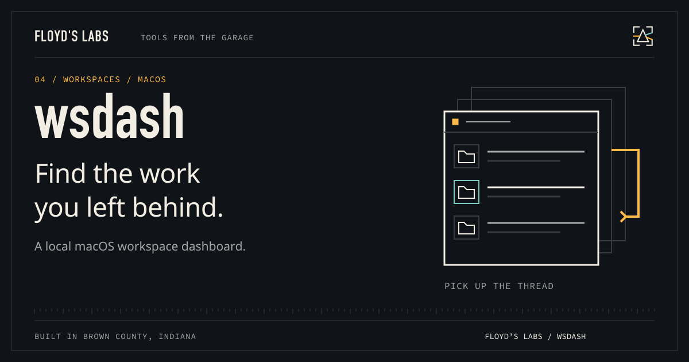
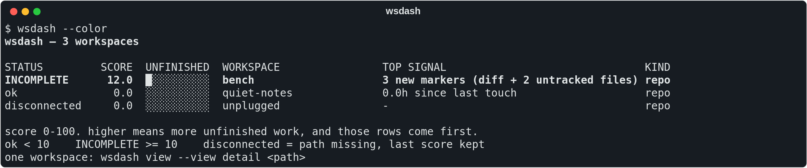
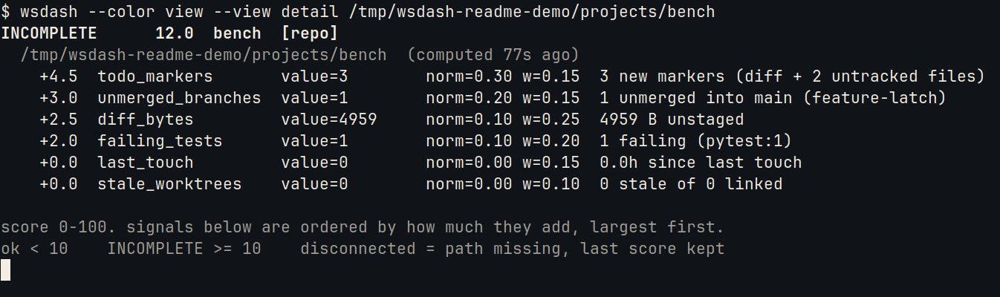
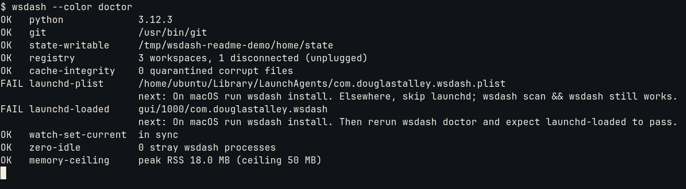

# wsdash



## Or: another brick in the unfinished pile

You left the work somewhere. wsdash scores it — git changes, stale worktrees, failing tests, the rest of the mess — prints a table, and exits. Nothing sits in the background charging rent.

Built at Floyd's Labs, in a garage in Brown County, Indiana. The coffee tastes like motor oil. 2:47 AM is a normal shift. Tools have to earn the desk.

**Pick up the work you left behind.**

[Download v0.2.0](https://github.com/CaptainPhantasy/wsdash/releases/tag/v0.2.0) · [Report a bug](https://github.com/CaptainPhantasy/wsdash/issues) · [Floyd’s Labs](https://floyd-labs-proving-ground.captainphantasy.chatgpt.site/open-source)

## Get it running

Requirements: **Python 3.11+ and Git. macOS if you want the launchd watchers.**

Two doors. Same commands on the other side: `wsdash` and `mydash`. `wsdash --version` prints `wsdash 0.2.0`.

### Release wheel

Download `wsdash-0.2.0-py3-none-any.whl` from the [v0.2.0 release](https://github.com/CaptainPhantasy/wsdash/releases/tag/v0.2.0), then install it in its own virtualenv:

```sh
python3 -m venv .venv
.venv/bin/python -m pip install ./wsdash-0.2.0-py3-none-any.whl
.venv/bin/wsdash --version
.venv/bin/wsdash scan
.venv/bin/wsdash
```

Call the binaries by path, or activate the virtualenv so `wsdash` is on your PATH.

### Checkout

From a clone, symlink the launchers in `bin/`. No pip. Run this from the repository root:

```sh
ln -sf "$PWD/bin/wsdash" ~/.local/bin/wsdash
ln -sf "$PWD/bin/mydash" ~/.local/bin/mydash
wsdash --version
wsdash scan
wsdash
```

`~/.local/bin` has to be on your PATH.

The core dashboard needs no third-party Python packages. `wsdash install` is the step that puts macOS launchd watchers and managed Git hooks on the machine. The ordinary dashboard does not do that. You run it, it prints, it leaves. `wsdash uninstall` takes those watchers and hooks back off.

A score is unfinished work, not a grade. High means you left a mess. It does not mean the project is bad. Deep edits can miss the launchd watch, because WatchPaths is shallow. Git hooks, or the cache expiring, still catch them.

Chat is optional. It wants your own provider credentials, and it can send selected context to that provider. Read [Security](docs/SECURITY.md), [Configuration](docs/CONFIGURATION.md), and [Known Issues](KNOWN_ISSUES.md) before you turn it on.

## What the terminal says

Screenshots of this tree, pointed at a throwaway fixture under `/tmp`. `bench` is unfinished and sorts first. `quiet-notes` is fine. `unplugged` is a path that left. No keys. No home directory. Not a mockup.



Status leads the row. Higher score means more unfinished work, and that row is listed first. `INCOMPLETE` is the loud label. `disconnected` means the path is missing and the last score is kept.





`wsdash doctor` prints a `next:` line when a check fails. This capture is Linux, so launchd is supposed to fail here. On a Mac, `wsdash install` is what those two lines are pointing at. The dashboard still runs without it: `wsdash scan`, then `wsdash`.

## What is in the box

The release includes `wsdash-0.2.0-py3-none-any.whl`, source where applicable, and `SHA256SUMS.txt`. Install from the tagged release's named assets. GitHub's automatic source archives are snapshots, not the release. After you download the matching files, check them:

```sh
shasum -a 256 -c SHA256SUMS.txt
```

## Show the work

```sh
python3 -m unittest discover -s tests -v
```

That covers workspace scoring, state storage, the CLI, and stubbed LLM/MCP behavior. The wheel is installed and run again in a fresh virtualenv. Paid provider calls are not in the suite.

## When it breaks

Open an issue with your platform, the version, the command, and the smallest reproduction you can stand. Leave credentials and personal transcripts out. See [CONTRIBUTING.md](CONTRIBUTING.md) and [SECURITY.md](SECURITY.md).

## License

There is no open-source license here that grants redistribution. A public download does not invent one. The restrictions that were already on this repository are still on it.

---

Bella checks the keyboard. Bowser watches the router.
